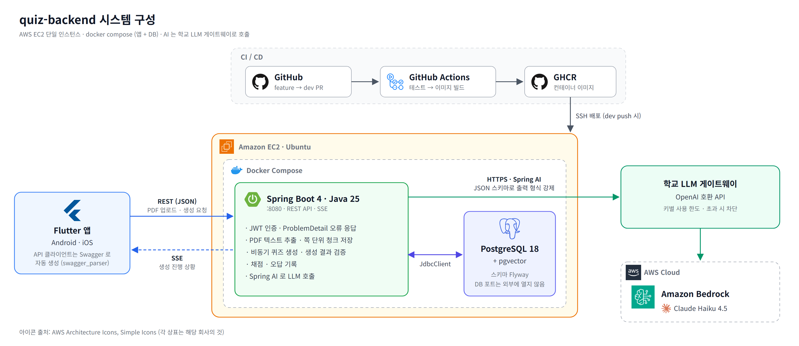
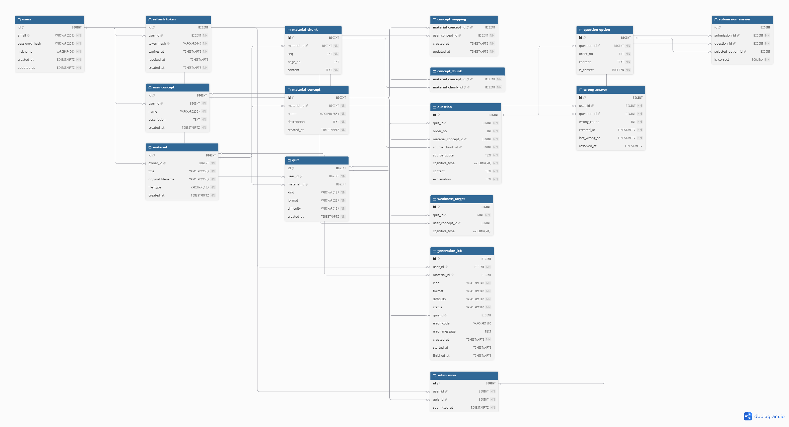

# quiz-backend — 강의자료 AI 퀴즈와 약점 분석

> 강의 PDF 를 올리면 AI 가 자료에 근거한 문제를 만들고,
> 푼 기록을 개념과 블룸 인지 유형 두 축으로 모아 약한 곳을 보여 주는 학습 서비스


> **이 레포는 백엔드다.** 앱(Flutter)은 별도 레포에서 팀원이 맡는다.
> AI 는 학교 LLM 게이트웨이(OpenAI 호환 API, 뒤에서는 Amazon Bedrock 의 Claude Haiku)로 부른다.

---

## 배경

학생들은 강의자료를 받아도 시험 직전에야 몰아서 보는 경우가 많다.
그런데 자료를 다시 읽는 것보다 **문제를 풀며 기억에서 꺼내 보는 쪽이 더 오래 남는다**는 것이 학습 연구로 알려져 있다(인출 연습, 시험 효과 — Roediger & Karpicke, 2006).
문제는 그 문제를 누가 만드느냐다.

```
문제 1: 문제를 만들 시간이 없다
  강의마다 스스로 문제를 만들기는 시간이 많이 듦
  → 결국 자료를 다시 읽는 공부로 돌아감

문제 2: 무엇을 모르는지보다 "어떻게" 모르는지가 더 안 보인다
  용어는 외웠지만 적용을 못 하는지, 개념 자체를 모르는지 구분되지 않음
  → 틀린 문제를 모아도 같은 공부를 반복함

문제 3: 풀이 이력이 남지 않는다
  ChatGPT 에 자료를 올려 문제를 받을 수는 있지만, 대화가 끝나면 풀이 기록이 사라짐
  → 내가 어디서 자주 틀리는지 쌓이지 않음
```

→ 이 앱은 네 가지로 이 문제를 푼다.

| 방향 | 설명 |
|------|------|
| 문제 제작 자동화 | 자료를 올리면 AI 가 개념별 문제를 바로 만든다 |
| 근거 있는 문제 | 문제마다 근거가 된 쪽과 문장을 보여 주고, 근거가 원문에 없는 문제는 걸러 낸다 |
| 약점 분석 | 풀이 기록을 블룸 교육목표 분류의 사고 유형(기억·이해·적용·분석·평가)과 개념 두 축으로 분석해 학습 프로필로 보여 준다 |
| 약점 보완 | 약한 개념과 유형으로 문제를 다시 만들고, 다시 볼 쪽과 공부법을 추천한다 (예정) |

근거를 걸러 내는 이유는 공부하려고 푸는 문제라, 그럴듯하지만 틀린 문제가 가장 해롭기 때문이다.

---

## 시스템 구성



---

## ERD



---

## 로드맵

- 이메일 로그인 + JWT, Refresh 토큰 회전과 재사용 감지
- PDF 텍스트 추출, 쪽 단위 청크 저장
- 비동기 퀴즈 생성 작업 + 생성 결과 검증(보기 수, 정답 수, 원문 인용 대조)
- SSE 로 생성 진행 상황 알림
- 제출과 채점, 오답 기록, 내 퀴즈 목록
- 학교 LLM 게이트웨이 연결(JSON 스키마로 출력 강제) + 사용자별 생성 횟수 제한
- Docker + GitHub Actions CI/CD 로 EC2 자동 배포

<details>
<summary>전체 로드맵 보기</summary>

```
✅ Phase 1: 프로젝트 세팅 (Spring Boot 4 + PostgreSQL 18/pgvector + Flyway) — #2
✅ Phase 2: DB 스키마 설계 (자료 · 개념 2단계 · 퀴즈 · 풀이) — #3
✅ Phase 3: PDF 텍스트 추출 (Spring AI PDF 리더) — #4
✅ Phase 4: 쪽 단위 청크 규칙 + 자료 저장 — #5
✅ Phase 5: Docker 배포 (EC2, docker compose) — #6
✅ Phase 6: GitHub Actions CI/CD (테스트 → GHCR 푸시 → EC2 배포) — #7, #8
✅ Phase 7: 전역 예외 처리 (ProblemDetail + 오류 코드) — #9
✅ Phase 8: 이메일 로그인 + JWT — #10
✅ Phase 9: Refresh 토큰 회전 + 재사용 감지 — #11
✅ Phase 10: 퀴즈 생성 흐름 (비동기 작업, 생성 결과 검증, 가짜 생성기) — #12
✅ Phase 11: 자료 업로드 · 목록, 퀴즈 조회 API — #13
✅ Phase 12: SSE 생성 진행 알림 — #14
✅ Phase 13: Swagger 를 앱의 코드 생성기(swagger_parser)에 맞춤 — #15
✅ Phase 14: 제출 · 채점, 오답 기록, 내 퀴즈 목록 — #16
✅ Phase 15: 학교 LLM 게이트웨이 연결 + 생성 횟수 제한 + 객관식 보기 섞기 — #17
⬜ Phase 16: 내 학습 분석 (블룸 인지 유형별 · 개념별 정답률)
⬜ Phase 17: 오답 노트 조회 + 문제 단위 다시 풀기
⬜ Phase 18: 약점 맞춤 퀴즈 (약한 개념과 인지 유형 위주로 생성)
⬜ Phase 19: 여러 자료에 걸친 같은 개념 묶기 (임베딩)
⬜ Phase 20: 운영 (요청 로그, 도메인 + HTTPS)
```

</details>

---

## 로컬 실행

### 준비
- JDK 25
- Docker Desktop: 로컬 DB(Postgres + pgvector)를 띄우고, 테스트도 Testcontainers 로 DB 를 띄운다

### 설정
`src/main/resources/application-local.properties.example` 을 같은 폴더에 `application-local.properties` 로 복사하고 `jwt.secret` 을 채운다.
이 파일은 커밋하지 않는다.

### 실행
```bash
./gradlew bootRun
```
- 프로필을 정하지 않으면 `local` 로 뜬다. 루트의 `compose.yaml` 로 DB 컨테이너를 같이 띄우고, 스키마는 Flyway 가 만든다.
- 퀴즈 생성은 AI 를 부르지 않는 가짜 생성기가 한다. 비용 없이 생성 흐름을 확인할 수 있다.
- API 문서: http://localhost:8080/swagger-ui/index.html

### 실제 AI 로 생성해 보기
학교 LLM 게이트웨이 키가 있을 때만 한다. 키마다 사용 한도가 있다.
```bash
SPRING_PROFILES_ACTIVE=local,llm LLM_BASE_URL=<게이트웨이 주소> LLM_API_KEY=<키> ./gradlew bootRun
```
IntelliJ 에서는 실행 설정의 환경 변수에 같은 세 값을 넣는다.

### 테스트
```bash
./gradlew test
```
테스트는 가짜 생성기로 돌아 게이트웨이를 부르지 않는다.
